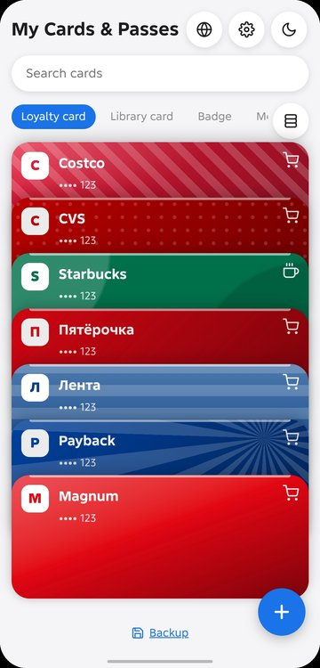
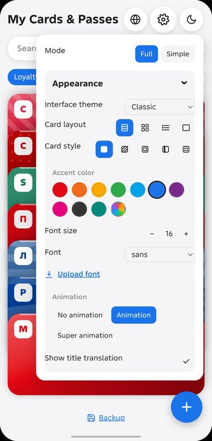
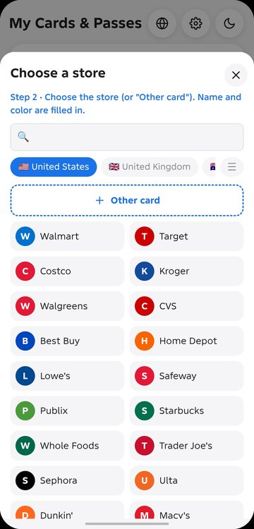
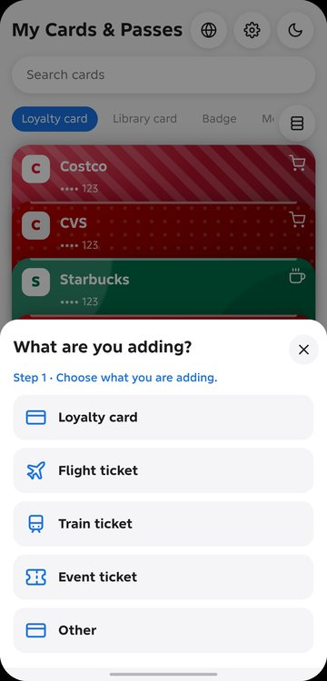
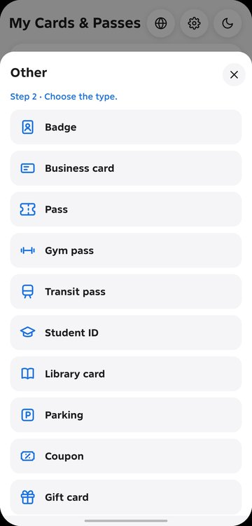
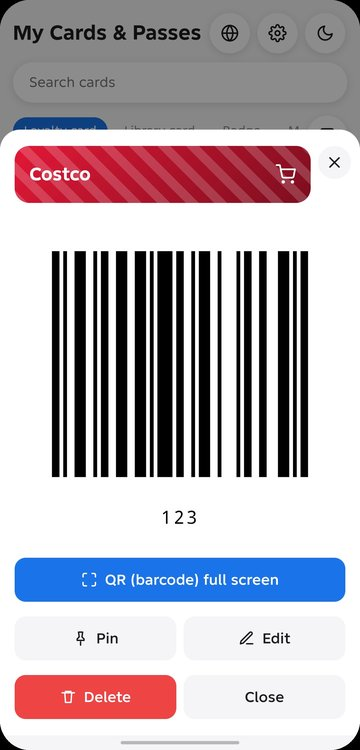
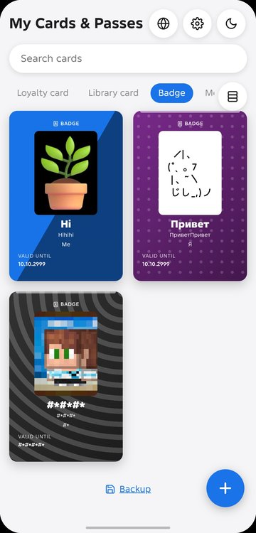
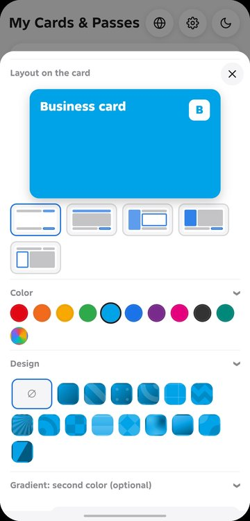

# My Cards & Passes

**All your loyalty cards, tickets and passes in one offline app.**

Scan a barcode or QR code, or add the details by hand, and pick a realistic card design. Your cards stay on your device. There is no account and no cloud.

[⬇️ Download the latest version](https://github.com/mrallayi/my-cards-and-passes/releases/latest) · [🌐 App page](https://mrallayi.github.io/my-cards-and-passes/docs/)

## Features

- 📷 **Scan or type in.** Add cards by scanning a barcode or QR code, or enter the number manually.
- 🏪 **Ready-made stores.** Choose from popular stores in several countries, or create your own card with "Other".
- 🎫 **Many card types.** Loyalty cards, flight, train and event tickets, badges, business cards, gym and transit passes, student IDs, library cards, parking, coupons and gift cards.
- 🎨 **Make it yours.** Choose card layouts, colors, patterns, fonts and interface themes, including a dark mode.
- 🔒 **PIN lock.** Protect sensitive passes with a PIN code.
- 💾 **Backup.** Save your cards and restore them when you need to.
- 📴 **Works offline.** Everything is stored on your device.

## Screenshots

  
  
  
  

  
  
  
  

## Installation

The app is for Android and is not published on Google Play.

1. Open the [latest release](https://github.com/mrallayi/my-cards-and-passes/releases/latest) on your phone and download the `.apk` file.
2. Open the downloaded file. If Android asks, allow installing apps from this source.
3. Tap **Install**.

## Privacy

My Cards & Passes does not collect, store or share your personal data on any server. All your cards stay on your device.
